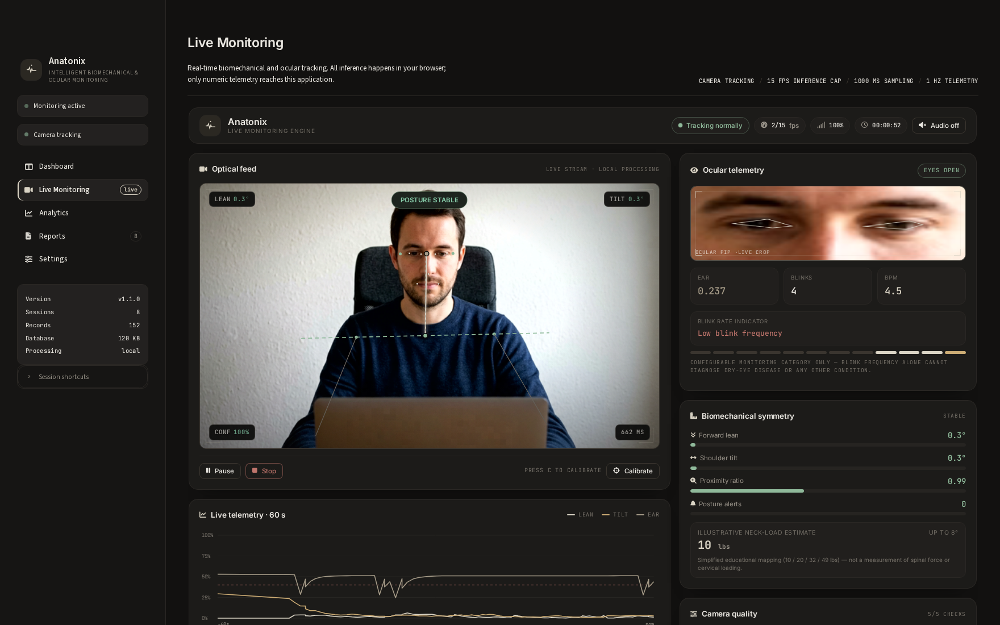
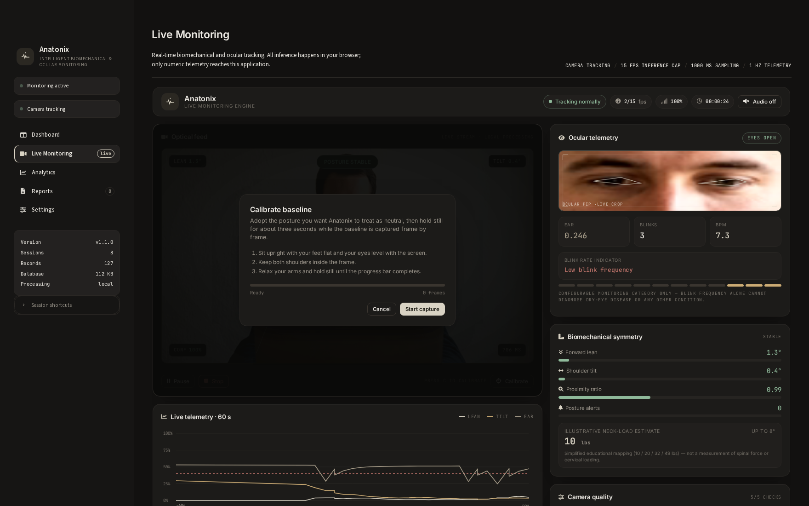
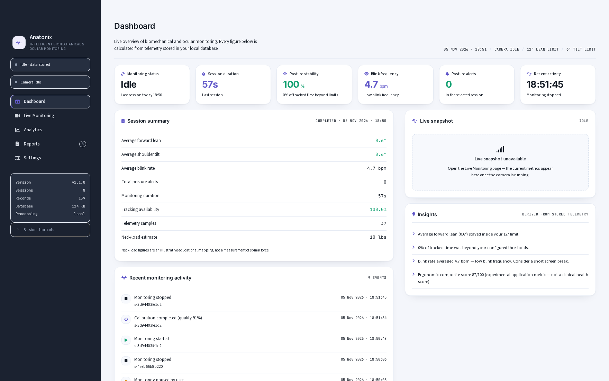

# Anatonix

**Intelligent biomechanical & ocular monitoring for desk workers.**

Anatonix is a local-first Streamlit application that uses your webcam to measure *forward
lean*, *shoulder tilt*, *proximity* and *eye-aspect-ratio / blink frequency* while you work.
Frame processing happens entirely in your browser (MediaPipe Tasks Vision, WASM/GPU); only
derived numbers — angles, ratios, counts, confidence — are sent to Python, stored in SQLite
and reported back to you as live telemetry, session analytics, CSV exports and PDF reports.



<p align="center"><em>Calibration capture — ocular inference pauses so pose frames arrive twice as fast.</em><br>
</p>

> **This is not a medical device.** Every posture, proximity, neck-load and blink figure is a
> webcam-derived estimate, not a clinical measurement. See [Limitations](#limitations).

---

## Contents

1. [Feature overview](#feature-overview)
2. [Architecture](#architecture)
3. [Design system and themes](#design-system-and-themes)
4. [Installation](#installation)
5. [Running the app](#running-the-app)
6. [Using Anatonix](#using-anatonix)
7. [How the measurements work](#how-the-measurements-work)
8. [Performance model](#performance-model-why-the-fps-counter-and-the-preview-differ)
9. [Configuration reference](#configuration-reference)
10. [Data, storage and privacy](#data-storage-and-privacy)
11. [Reports and exports](#reports-and-exports)
12. [Testing](#testing)
13. [Troubleshooting](#troubleshooting)
14. [Limitations](#limitations)
15. [Deviation from the original single-file brief](#deviation-from-the-original-single-file-brief)
16. [Project layout](#project-layout)
17. [Development log](#development-log)

---

## Feature overview

| Area | What it actually does |
| --- | --- |
| **Live monitoring** | Webcam preview with a skeleton overlay (ears, eyes, shoulders), live angle read-outs, posture state chip, inference FPS, tracking confidence and per-frame latency. |
| **Ocular telemetry** | Zoomed eye crop rendered from the live frame with an eye-contour overlay, EAR value, blink counter, blink rate (bpm) and a non-clinical blink-rate indicator. |
| **Measurements** | Forward lean (°, relative to your own baseline), shoulder tilt (°), proximity ratio (relative shoulder span), EAR, blink rate, tracking confidence. |
| **Calibration** | 3-second guided capture producing a personal baseline (pitch, shoulder tilt, shoulder span) and a quality score. Posture is judged against *your* baseline, not a generic one. |
| **Alert engine** | Threshold + sustained-frames debounce + hysteresis recovery, per-alert-type cooldown, dismiss/snooze, in-page banner, optional spoken alert (Web Speech API) and toast notifications. |
| **Break reminders** | Configurable interval (5–180 min), optional spoken reminder, recorded as an event. |
| **Persistence** | SQLite: sessions, 1 Hz telemetry, alerts, calibrations, settings, events, export log. Unavailable values are stored as `NULL`, never as `0`. |
| **Analytics** | Session / 7-day / 30-day / custom / all-time ranges, 6 insight cards, 7 Chart.js charts (lean, tilt, EAR, blink rate, distribution, session durations, daily consistency), previous-period comparison, composite score. |
| **Reports** | Session history table, per-session CSV, per-session PDF (summary tables, trend chart, limitations, privacy statement), range CSV export, storage stats, session deletion. |
| **Settings** | 6 tabs — monitoring thresholds, ocular tuning, notifications/audio, appearance, privacy & data, about. Every value is validated and clamped server-side and persisted. |
| **Degradation** | Camera denied, model download failure, missing landmarks, DB failure and unsupported speech are all handled with explicit UI states instead of fake numbers. |
| **Theming** | Two complete palettes (light "paper dashboard", dark "warm terminal") driven by one token set; switch in Settings → Appearance and the shell, the camera panel and the charts follow together. |

---

## Architecture

```
Browser (sandboxed component)                Python (Streamlit)
─────────────────────────────                ──────────────────
vision.js      MediaPipe Tasks Vision        app.py            page dispatch
posture.js     lean / tilt / proximity       views/            5 page renderers
ocular.js      EAR / blink state machine     components/       declare_component bridges
calibration.js baseline capture              backend/
alerts.js      hysteresis + cooldown           database.py        SQLite access layer
telemetry.js   1 Hz sampler + buffer           session_manager.py payload validation
bridge.js      Streamlit component protocol    data_validation.py sanitising / clamping
app.js         orchestration                   posture_math.py    server-side geometry
ui.js          DOM rendering, canvas, HUD      analytics.py       aggregation & insights
styles.css     design system                   report_generator.py CSV + PDF
                                               analytics / reports / settings views
        ▲                                                      │
        └──────────── streamlit:setComponentValue ─────────────┘
              (numeric telemetry only — never pixels)
```

* **Separation of concerns.** Vision (`vision.js`, `posture.js`, `ocular.js`) knows nothing
  about Streamlit. Business logic (`alerts.js`, `calibration.js`, `telemetry.js`) knows
  nothing about the DOM. `ui.js` only renders. `app.js` wires them together.
* **The component bridge is JSON only.** The iframe batches telemetry + alerts +
  calibration + events and pushes them with `streamlit:setComponentValue`; Streamlit replies
  with `streamlit:render` carrying settings, calibration and session information. No image,
  video frame or biometric template ever crosses that boundary.
* **Streamlit never reruns during monitoring.** Reruns only happen when a component value
  arrives (≥ 5 s batches, or on explicit events), so the live loop and the camera are never
  interrupted.
* **Validation is duplicated on purpose.** The browser clamps values for a clean UI; the
  Python side re-validates and clamps everything before it touches SQLite.

---

## Design system and themes

The whole application — Streamlit shell, monitoring component and Chart.js views — is painted
from **one token set** defined in [`config.py`](config.py):

```
config.THEMES  ──►  theme_css_variables()  ──►  :root { --anx-… }  ──►  ui/theme.css
                                                    │
                                                    ├─► frontend/styles.css   (component iframe,
                                                    │        palettes mirrored under
                                                    │        :root[data-theme="light"])
                                                    └─► charts_frontend/charts_app.js
                                                                (palette objects, per theme)
```

Nothing in the UI hard-codes a colour: hover, tinted chips and progress fills are derived with
`color-mix(in srgb, var(--anx-accent) 16%, transparent)`, so a new accent propagates everywhere.

| | **Light** — "paper dashboard" | **Dark** — "warm terminal" |
| --- | --- | --- |
| Page | `#f4f6fb` cool grey canvas | `#121110` near-black canvas |
| Surfaces | `#ffffff` cards, 1 px `#e6ebf4` hairline, soft shadow | `#1c1b19` cards, 1 px `#2a2724` hairline, no glow |
| Navigation | deep navy rail `#1b2230` with light type and an accent bar on the active item | `#161514` rail, active item on `#232120` |
| Accent | indigo `#6259ca` (filled buttons, focus rings) | warm sand `#d9d3c4` (light pill buttons, muted charts) |
| Semantic | `#12a171` / `#d98a10` / `#d7514a` | `#8fb99a` / `#cbab74` / `#c0756c` |
| Charts | indigo–lavender–green ramp | desaturated sand → sage → amber ramp |

Switch it in **Settings → Appearance → Colour theme** (`dark` / `light`, persisted in SQLite).
The choice is sent to the component with every render (`settings.theme`), so the camera panel,
its canvas overlays and the analytics charts all switch together without a reload.



Implementation notes worth knowing:

* **Type** is Inter throughout, with JetBrains Mono reserved for numeric read-outs so digits stay
  column-aligned. Panel titles are sentence case; only micro-labels are letterspaced capitals.
* **Overlays that sit on the camera stage** use a dedicated `--anx-on-video-*` token group
  (always light) because the video backdrop stays dark in both themes.
* **Canvas renderers read tokens at draw time** (`getComputedStyle(document.documentElement)`),
  which keeps the landmark overlay, the ocular crop and the live sparkline in step with the theme.
* **Tables are rendered by `ui.kit.table`** rather than `st.dataframe`. Streamlit paints dataframes
  on a canvas whose theme is fixed at server start, so a dataframe could not follow the in-app
  switch; the token-styled table keeps headers, numerics and progress bars themed in both modes.

### What changed in 1.1.0

The application was re-skinned onto the two-palette design system described above (the previous
release used a single dark-only palette). No measurement, page, control or setting changed —
only the visual language: tokens instead of hard-coded colours, the component's canvas renderers
and Chart.js views reading those tokens, `ui.kit.table` in place of `st.dataframe`, and the
Streamlit control layer (sliders, radios, toggles, selects, tabs, buttons, disabled states)
re-pointed at the same variables.

## Installation

### Requirements

* Python **3.10+** (tested on 3.11–3.13), 64-bit
* A modern Chromium-based browser (Chrome / Edge / Brave) or Firefox with webcam + WebAssembly
* Internet access **on first load only** — MediaPipe Tasks Vision (`vision_bundle.mjs`, pinned
  to `0.10.14`) and the two `.task` models are fetched from CDN/cache on first use.
  Chart.js is vendored locally, so charts work offline.
* No API keys, no accounts, no cloud services.

### Quick start (Linux / macOS)

```bash
cd anatonix
./run.sh
```

`run.sh` creates `.venv`, installs `requirements.txt` on first launch (≈ 25 s, ≈ 600 MB of
disk), then starts Streamlit on <http://localhost:8501>. Re-running it is instant — it only
reinstalls when `requirements.txt` changes. Pass `--port 8700` to change the port, or any
other flag straight through to `streamlit run`.

> **Arch / Manjaro note.** `python -m streamlit run app.py` with the system interpreter fails
> with `No module named streamlit` because Arch does not install pip packages into
> `/usr/bin/python` (externally managed environment). Use `./run.sh`, or do the manual steps
> below. `python -m venv` needs the `venv` module, which ships with the `python` package —
> if it errors, `sudo pacman -S python python-pip`.

### Manual steps (any OS)

```bash
# 1. Get the project
cd anatonix

# 2. Create and activate a virtual environment
python -m venv .venv
# Windows
.venv\Scripts\activate
# macOS / Linux
source .venv/bin/activate

# 3. Install dependencies
python -m pip install --upgrade pip
python -m pip install -r requirements.txt

# 4. Run
python -m streamlit run app.py
```

Dependencies: `streamlit`, `pandas`, `numpy`, `reportlab`, `matplotlib` (PDF charts), plus
`pytest` for the test suite. MediaPipe is **not** a Python dependency — it runs in the browser.

---

## Running the app

```bash
python -m streamlit run app.py
```

The app opens at <http://localhost:8501>. Grant camera permission when the browser asks.
Use `--server.port 8700` to pick a different port.

On first launch the SQLite database is created automatically at `data/anatonix.db` with all
default settings. Nothing is recorded until you press **Start monitoring**.

---

## Using Anatonix

1. **Live Monitoring → Start monitoring.** The browser asks for camera access. Once
   permission is granted the preview appears, the skeleton overlay locks on and the HUD
   starts reporting metrics at ~15 inference FPS.
2. **Calibrate (recommended, ~10 seconds).** Sit the way you *want* to sit, press
   <kbd>C</kbd> (or the **Calibrate** button) and hold still for the 3-second capture. You get
   a personal baseline, a quality score and a shoulder-span reference. From that point on,
   *forward lean* and *proximity* are expressed relative to your baseline; before calibration
   they are marked *raw / uncalibrated*.
3. **Work.** Telemetry is sampled at 1 Hz and flushed to the app in batches. Threshold
   breaches raise an alert banner, a toast and (optionally) a spoken alert. Alerts clear on
   recovery, re-arm after the cooldown, and can be dismissed/snoozed.
4. **Stop monitoring.** The camera track is stopped and released, the session is closed with
   its duration, and the standby overlay returns.
5. **Review.** *Dashboard* summarises your latest session, *Analytics* shows trends for the
   selected range, *Reports* exports CSV/PDF files.

Keyboard shortcuts inside the monitoring panel: <kbd>C</kbd> calibrate, <kbd>Esc</kbd> close
dialogs, <kbd>Space</kbd> pause/resume.

---

## How the measurements work

All landmarks come from MediaPipe in **normalised image coordinates** on the un-mirrored
frame; the preview is mirrored for display only.

| Metric | Definition | Range / unit |
| --- | --- | --- |
| **Forward lean** | Angle of the *ear midpoint → shoulder midpoint* vector away from vertical, minus the calibrated baseline, clamped at 0. | 0–90 ° |
| **Shoulder tilt** | Angle of the shoulder line away from horizontal. | 0–45 ° |
| **Proximity ratio** | Current shoulder span ÷ calibrated shoulder span. `1.00` = same distance from the camera. | 0.3–3.0 (unitless) |
| **EAR** | `(|p2−p6| + |p3−p5|) / (2·|p1−p4|)` using the six-point eye contour of both eyes, averaged. | typically 0.15–0.40 |
| **Blink** | EAR drops below `ear_threshold`, stays below for ≥ `blink_min_duration_ms`, then rises again; debounced by `blink_debounce_ms`. | count |
| **Blink rate** | Blinks per minute over a rolling 60 s window. | bpm |
| **Tracking confidence** | Weighted blend of pose visibility, face detection and required-landmark presence. | 0–1 |
| **Illustrative neck-load estimate** | Static educational mapping of head angle bands to commonly cited load figures (10 / 20 / 32 / 49 lb). | lb (illustrative) |

**Posture state machine:** `good → elevated` after `bad_frame_count` consecutive frames above
threshold, `elevated → good` after `recovery_frame_count` frames back below it. Alert types
(posture, tilt, proximity, blink) each have their own latch and cooldown.

**Missing landmarks.** If the face or shoulders are not visible, the affected metrics are
`null` — the UI shows `—` and the value is written to SQLite as `NULL`. Aggregations ignore
`NULL`s and report `insufficient data` instead of inventing numbers.

---

## Performance model (why the FPS counter and the preview differ)

Two numbers matter and they are deliberately decoupled:

* **Preview smoothness** — the camera picture is the `<video>` element itself, composited by
  the browser. It always runs at the camera's native frame rate (usually 30 fps) no matter how
  long a model inference takes. Only the landmark overlay and the eye crop are drawn on
  canvases, and they refresh as inference results arrive.
* **Inference rate** — how often pose + face landmarks are actually computed. This is the
  number shown in the header chip.

The chip shows `measured / cap` whenever inference is the bottleneck (for example `14 / 30`),
and its tooltip breaks the cost down per model (`pose 42 ms + face 31 ms, GPU delegate`). The
cap is a *ceiling*, not a promise: on a laptop that needs 65 ms for a pose+face pass, 30 fps is
physically impossible.

Anatonix also keeps a **frame budget**: inference may occupy at most 70 % of wall-clock time,
so the browser always has room to repaint the overlay, the eye crop and the HUD. When frames
get expensive the scheduler stretches the interval (never below 6 fps) instead of saturating
the thread — a saturated main thread is what makes a webcam preview stutter and flicker.

Calibration runs **pose-only** for its capture window: ocular inference is paused, which
roughly doubles the number of usable frames collected in the same three seconds (the ocular
card shows `Paused for calibration` while it happens).

If you want a higher inference rate: lower the cap in *Settings → Monitoring* to something the
machine can sustain, close other GPU-heavy tabs, or reduce the camera resolution.

## Configuration reference

Settings live in the database (`settings` table) and are editable on the **Settings** page.
Bounds are enforced in `config.SETTING_BOUNDS` and re-checked by `backend/data_validation.py`.

| Key | Default | Bounds | Meaning |
| --- | --- | --- | --- |
| `forward_lean_threshold` | 12.0 | 2–45 | Lean beyond this raises a posture alert (°) |
| `shoulder_tilt_threshold` | 6.0 | 1–25 | Tilt beyond this raises a tilt alert (°) |
| `bad_frame_count` | 20 | 3–200 | Frames above threshold before the state changes |
| `recovery_frame_count` | 15 | 3–200 | Frames below threshold to recover |
| `tracking_sensitivity` | 0.5 | 0–1 | Minimum visibility to accept a landmark |
| `alert_cooldown_seconds` | 3.5 | 0.5–60 | Minimum gap between alerts |
| `sample_interval_ms` | 1000 | 500–10000 | Telemetry sampling period |
| `inference_fps` | 15 | 2–30 | Model inference cap (an upper bound, not a promise) |
| `inference_duty` | 0.7 | 0.5–1.0 | Share of wall-clock time inference may occupy; the rest is reserved for painting the UI. `1.0` gives inference everything (preview may stutter) |
| `camera_device_id` | — | — | Preferred camera (browser device id) |
| `mirror_preview` | true | — | Mirror the preview only |
| `smoothing_alpha` | 0.25 | 0.05–1.0 | EMA smoothing factor |
| `ear_threshold` | 0.19 | 0.05–0.35 | EAR below this counts as a closed eye |
| `blink_min_duration_ms` | 60 | 10–500 | Minimum closure duration |
| `blink_debounce_ms` | 120 | 50–1000 | Refractory period between blinks |
| `blink_low_bpm` | 8.0 | 1–20 | "Low blink frequency" indicator threshold |
| `blink_reference_bpm` | 12.0 | 2–40 | Reference line on the blink chart |
| `audio_enabled` | false | — | Spoken alerts |
| `audio_volume` / `speech_rate` | 0.8 / 1.05 | 0–1 / 0.5–2.0 | Speech synthesis parameters |
| `voice_name` | — | — | Preferred system voice |
| `break_reminders_enabled` | true | — | Break reminder toasts |
| `break_interval_minutes` | 30 | 5–180 | Reminder interval |
| `break_audio` | false | — | Speak the break reminder |
| `theme` / `density` | dark / comfortable | — | Appearance |
| `chart_animations` | true | — | Chart.js animation toggle |
| `show_neck_load` | true | — | Show the neck-load card |
| `telemetry_retention_days` | 180 | 1–3650 | Informational retention window |

Environment overrides: `ANATONIX_DB` (database path) and `ANATONIX_LOG` (log file path).

---

## Data, storage and privacy

* **Processing is local.** Inference runs in your browser tab. Frames are never uploaded,
  recorded to disk or sent to the Python side. The eye crop is drawn on an in-memory canvas
  and discarded on the next frame.
* **No biometric templates.** No facial images, embeddings or landmark histories are stored —
  only the derived numbers listed above.
* **What is stored** (SQLite, `data/anatonix.db`):

  | Table | Contents |
  | --- | --- |
  | `sessions` | session id, start/end timestamps, duration |
  | `telemetry` | timestamp, lean, tilt, EAR, blink rate, proximity, confidence, posture state |
  | `alerts` | type, measurement, threshold, message, timestamp |
  | `calibrations` | baseline pitch/tilt/span, quality, frames used |
  | `settings` | key/value pairs |
  | `events` | monitoring started/stopped/paused, calibration, alerts, break reminders, exports |
  | `exports` | generated CSV/PDF files (path, kind, size) |

* **Controls.** Stop monitoring releases the camera immediately. *Settings → Privacy & data*
  can purge telemetry, export everything, or delete sessions (with the derived rows). The
  *Reports* page shows database size and lets you delete individual sessions.
* **Files you create** live under `exports/` and can be deleted from the Reports page.

---

## Reports and exports

* **Session CSV** — `timestamp, forward_lean_deg, shoulder_tilt_deg, ear_value,
  blink_rate_bpm, proximity_ratio, tracking_confidence, posture_status`. Empty cells are true
  `NULL`s.
* **Session PDF** — title block, session information, posture summary, ocular summary, alert
  history, trend chart (matplotlib), measurement limitations and a privacy statement.
* **Range CSV** — every telemetry row in the selected window, for use in a spreadsheet.
* Exports are written to `exports/` and additionally streamed to your browser; the *Reports*
  page lists them with sizes so you can clean up.

---

## Testing

```bash
# Python: 133 tests (geometry, validation, database, analytics, reports, session manager,
#                 design-system contract)
python -m pytest

# JavaScript: 40 tests (vision maths, EAR/blink state machine, alerts, calibration,
#                telemetry, inference scheduler)
cd frontend && node --test tests/
```

The suites cover:

* `test_posture.py` — angle geometry, proximity, smoothing, degenerate landmarks
* `test_validation.py` — clamping, replay protection, malformed payloads, event sanitising
* `test_database.py` — schema, null handling, idempotent inserts, session recovery, deletions
* `test_analytics.py` — range aggregation, insufficient-data handling, comparisons, insights
* `test_reports_and_session.py` — CSV/PDF generation, session lifecycle, alert persistence
* `test_theme.py` — palette parity between themes, token → CSS emission, chart colours per theme,
  `ui.kit.table` escaping / missing-value handling
* `frontend/tests/logic.test.js` — EAR/blink detection, alert hysteresis and cooldown, posture
  maths, calibration quality, telemetry batching, inference scheduling/frame budget

Both suites pass clean (see [Development log](#development-log)).

### Optional browser smoke test

`tools/browser_smoke_test.py` drives a real Chromium instance against a running app with
Chromium's fake-camera support, so the whole pipeline can be checked without a physical webcam
(19 checkpoints: page rendering, component handshake, model load, live metrics, eye crop,
calibration, pause/resume, camera release, persistence, console errors).

```bash
python -m pip install playwright && python -m playwright install chromium
python tools/browser_smoke_test.py --feed /path/to/face.y4m    # needs a Y4M/MJPEG clip
```

### Verified browser run

The full pipeline was exercised end-to-end in a headless Chromium with a synthetic 15 FPS
camera feed: component mounting, camera permission, MediaPipe model load, skeleton overlay,
live metrics, calibration capture, alert firing, pause/resume, keyboard shortcuts, camera
release on stop, telemetry persistence, analytics rendering, CSV/PDF downloads and settings
persistence. Results are recorded in [`DEVELOPMENT_CHECKLIST.md`](DEVELOPMENT_CHECKLIST.md).

---

## Troubleshooting

| Symptom | Cause / fix |
| --- | --- |
| "Camera access was denied" | Grant permission in the browser site settings, then press Start again. The app cannot read camera state otherwise. |
| "Vision models could not be loaded" | First load needs internet to fetch `vision_bundle.mjs` + `.task` files from jsDelivr / Google Cloud Storage. Check the network, or the CDN/proxy in your environment, then reload. |
| Blank preview, no landmarks | Another application holds the camera; or the room is too dark (`Lighting adequate` check turns red). Close other video apps and re-open. |
| Low FPS (chip shows `14 / 30`) | Inference is the bottleneck, not the preview. The chip tooltip shows the per-model cost; lower `inference_fps` to a rate your machine sustains, or close other GPU-heavy tabs. The preview stays smooth regardless. |
| Colours look wrong after switching theme | The theme is stored in SQLite (`settings.theme`). If the shell changed but a panel did not, hard-reload the page (Ctrl/Cmd-Shift-R) — the monitoring iframe is cached by the browser, and its palette is delivered with the component arguments. |
| Preview flickers or stutters | Fixed in v1.0.0 → v1.0.1: the preview is now the native video element instead of a canvas redrawn by JS, `backdrop-filter` was removed from overlays that sit on the video, and inference is capped at 70 % of the frame budget. |
| No sound | Browsers require a user gesture before speech synthesis; use the **Audio** toggle in the panel or enable it in Settings → Notifications. Check the system voice list. |
| Charts empty | Charts plot stored telemetry only. Record at least one session; ranges without data show "insufficient data" by design. |
| `No module named streamlit` / `ModuleNotFoundError: streamlit` | You are running the system Python without the project environment. Either use `./run.sh`, or activate the venv first: `source .venv/bin/activate` (Windows: `.venv\Scripts\activate`). Arch/Manjaro never installs pip packages into `/usr/bin/python`, so this is expected there. |
| `error: externally-managed-environment` on `pip install` | Same cause: pip refuses to touch the system interpreter. Create and use a virtual environment as above; do not pass `--break-system-packages`. |

Logs are written to `data/logs/anatonix.log`.

---

## Limitations

* Webcam geometry is **2-D and perspective-sensitive**: camera height, tilt, distance and lens
  distortion all shift the numbers. Compare your own measurements over time, never across
  people or setups.
* **Forward lean** is a geometric proxy relative to your calibrated baseline; it is not a
  clinical cervical angle.
* **Shoulder tilt** in the image plane is affected by camera roll, seat rotation and clothing.
* **Proximity ratio** is a relative indicator derived from shoulder span. It is *not* a
  distance in centimetres and not a screen-distance measurement.
* **Blink rate** comes from an EAR heuristic; low blink frequency alone cannot diagnose
  dry-eye disease or any other condition. Blink detection also under-reports when inference
  FPS is very low (closed eyes may fall between frames).
* The **Illustrative Neck-Load Estimate** is an educational mapping of widely circulated
  posture illustrations. It is not a measurement of spinal force or cervical loading.
* Anatonix is a self-monitoring aid: its estimates are not clinically validated and it cannot
  diagnose any condition. Consult a qualified professional for medical concerns.

---

## Deviation from the original single-file brief

The original task sheet (`uploads/task.md`) described a prototype in a **single file**
(`anapystream.py`) with inline HTML, Tailwind via CDN, the legacy `@mediapipe/pose` solution
API, in-memory-only records and a hardcoded interpreter path
(`C:\Users\SUPRAKASH\...\python.exe`). The main brief required a modular, persistent,
report-capable product, so Anatonix follows the main brief. Concretely:

| Brief item | What Anatonix does instead | Why |
| --- | --- | --- |
| One giant file | Modular packages: `frontend/`, `backend/`, `views/`, `components/`, `ui/` | Testability, separation of vision / logic / persistence |
| Tailwind CDN | Hand-written design system in `frontend/styles.css` + `ui/theme.css` | Works offline, matches the dark instrument-panel aesthetic, no CDN dependency |
| Legacy `@mediapipe/pose` + `face_mesh` | MediaPipe **Tasks Vision 0.10.14** (`pose_landmarker_lite`, `face_landmarker`) | The legacy solution API is deprecated and was unreliable in testing; the Tasks API was verified working with GPU delegate |
| In-memory records only | SQLite persistence with validation, retention and deletion | Required for analytics, reports and honest historical data |
| Hardcoded `C:\Users\SUPRAKASH\...python.exe` | `python -m streamlit run app.py` inside a virtual environment | The hardcoded path is machine-specific and would not run anywhere else |
| `components.html` glue | A real bidirectional custom component (`declare_component`) with a documented message protocol | `components.html` cannot send messages back to Python |

Every *functional* feature enumerated in the task sheet is implemented: skeleton/HUD overlay,
eye PIP canvas, angle gauges, audio shout, CSV export, calibration, break reminders, session
tracking and the privacy disclaimers.

---

## Project layout

```
anatonix/
├── app.py                      # entry point, page routing, sidebar
├── config.py                   # both theme palettes, settings, MediaPipe URLs, landmark indices
├── run.sh                      # one-command launcher (venv + deps + streamlit)
├── requirements.txt
├── pytest.ini
├── .streamlit/config.toml      # neutral widget theme + usage-stats opt-out
├── assets/                     # icons, favicon, vendored Chart.js
├── backend/                    # persistence, validation, geometry, analytics, reports
│   ├── database.py
│   ├── session_manager.py
│   ├── data_validation.py
│   ├── posture_math.py
│   ├── analytics.py
│   ├── report_generator.py
│   └── logging_setup.py
├── components/                 # Streamlit custom-component bridges
│   ├── monitoring_component/
│   └── charts_component/
├── frontend/                   # the live monitoring component (vanilla JS, no build step)
│   ├── index.html  styles.css   # component markup + token-driven stylesheet
│   ├── vision.js  posture.js  ocular.js  calibration.js  alerts.js
│   ├── telemetry.js  bridge.js  ui.js  app.js
│   └── tests/logic.test.js
├── charts_frontend/            # Chart.js analytics component
├── ui/                         # theme.css (shell) + kit.py (cards, tiles, tables, escaping)
├── views/                      # dashboard, monitoring, analytics, reports, settings
├── tests/                      # 133 pytest tests
├── docs/screenshots/
├── data/                       # SQLite database + logs (created at runtime)
└── exports/                    # generated CSV/PDF files
```

---

## Development log

See [`DEVELOPMENT_CHECKLIST.md`](DEVELOPMENT_CHECKLIST.md) for the verified feature list,
the bugs found during testing and how they were fixed.

Built with Streamlit, MediaPipe Tasks Vision, Chart.js, ReportLab and Matplotlib.
No analytics, no telemetry, no accounts — everything stays on your machine.
